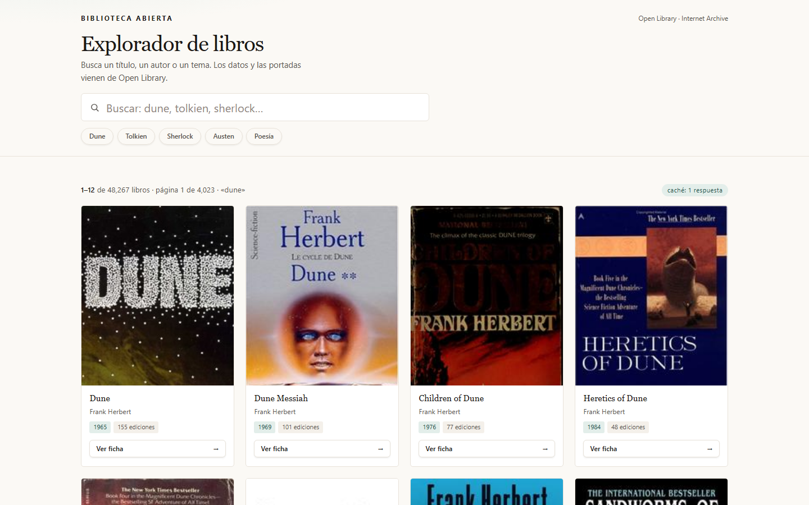
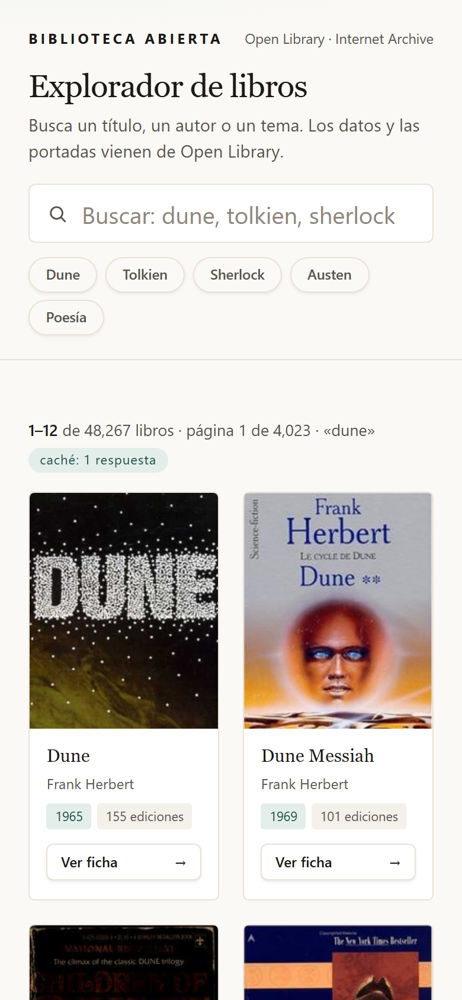
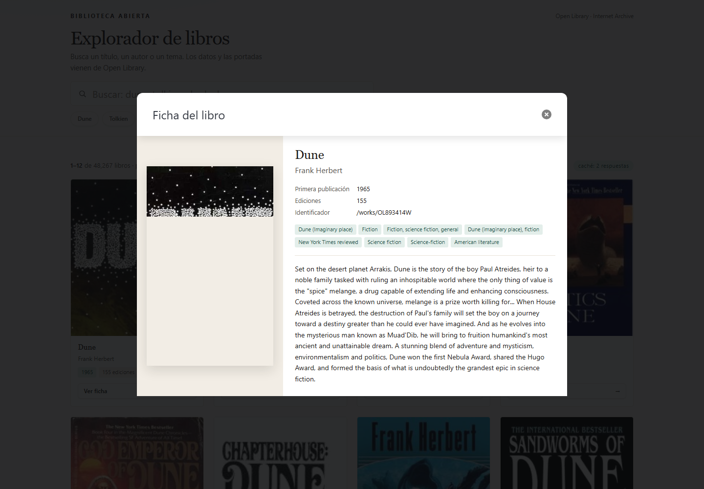
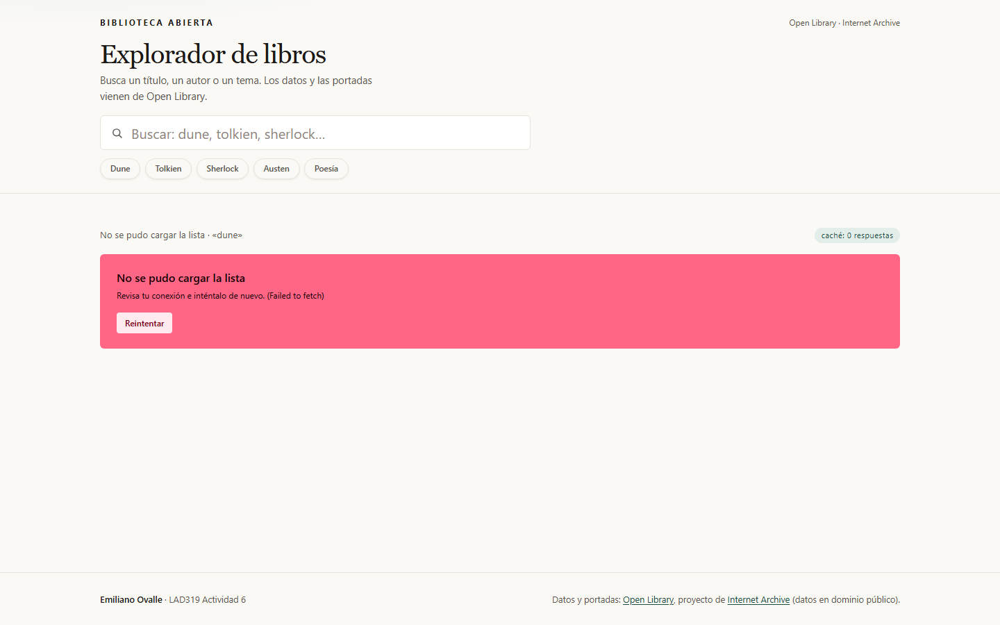
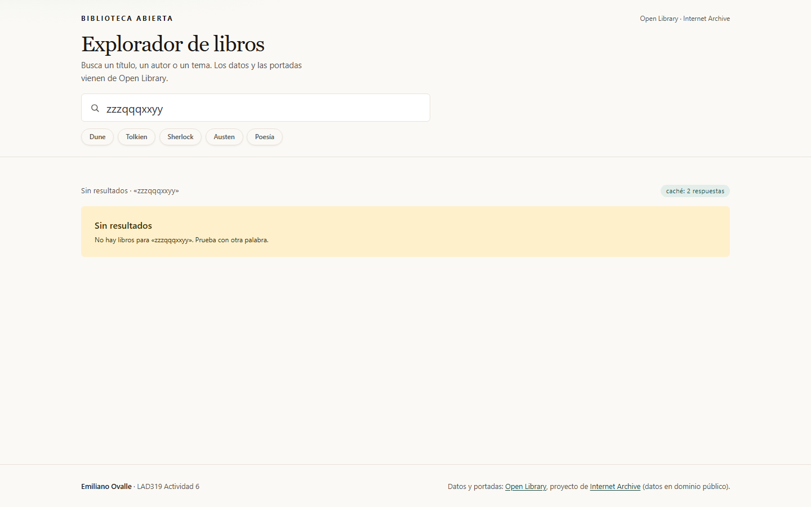
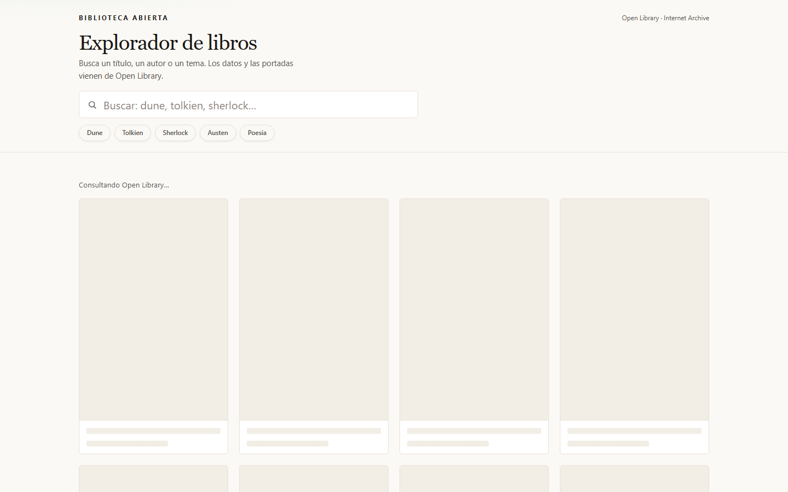

# Biblioteca Abierta — Explorador de libros con la API de Open Library

Actividad 6 de **LAD319 · Desarrollo de Aplicaciones Web** (Universidad La Salle Bajío).
Alumno: **Emiliano Ovalle**.

Página que aplica el patrón de la Pokédex —**lista → detalle → tarjetas → rejilla**— a la API pública de
[Open Library](https://openlibrary.org/developers/api), construida con **HTML + CSS + JavaScript puro y Bulma**,
sin frameworks ni proceso de compilación.



## Publicar en GitHub Pages

El proyecto es 100 % estático: no hay que compilar nada. Todas las rutas son **relativas**, así que
funciona igual en `usuario.github.io` que en `usuario.github.io/repositorio/`.

```bash
git init
git add .
git commit -m "Actividad 6: explorador de libros con Open Library"
git branch -M main
git remote add origin https://github.com/USUARIO/REPOSITORIO.git
git push -u origin main
```

Luego, en GitHub: **Settings → Pages → Build and deployment**

- **Source:** `Deploy from a branch`
- **Branch:** `main` · carpeta `/ (root)`

En uno o dos minutos el sitio queda en `https://USUARIO.github.io/REPOSITORIO/`.

Detalles ya resueltos en el proyecto:

- **`.nojekyll`** evita que Pages procese el sitio con Jekyll (si no, ignora archivos que empiezan con `_`).
- **Nombres en minúsculas** en `css/`, `js/`, `capturas/` y `assets/`: Linux distingue mayúsculas y un
  `Estilos.css` daría 404 aunque en Windows se viera bien.
- **`404.html`** propia, con un enlace relativo (`./`) que regresa al explorador.
- **`assets/favicon.svg`** para que no aparezca el 404 de `favicon.ico` en la consola.
- **Todo por HTTPS**: la API (`openlibrary.org`), el CDN de Bulma y las portadas, sin contenido mixto.
- **CORS abierto** en la API (`Access-Control-Allow-Origin: *`), así que el `fetch` funciona desde el
  dominio de Pages sin proxy ni backend.

La carpeta `documento/` y `capturas/` también se publican; no estorban, pero si quieres que el sitio
contenga solo la página, puedes excluirlas de la rama publicada o moverlas a otra rama.

## Cómo abrirla en local

**Opción 1 (la más simple):** doble clic en `index.html`. No usa módulos ES, así que funciona desde `file://`.

**Opción 2:** servidor local, por si el navegador restringe algo:

```bash
python -m http.server 8765
# luego abre http://127.0.0.1:8765/
```

Necesita conexión a internet: los datos y las portadas vienen de `openlibrary.org`.

## Qué hace

| Requisito de la actividad | Dónde está |
|---|---|
| **Lista** con paginación | `buscarLibros()` → `GET /search.json?q=…&page=…&limit=12` |
| **Detalle** | `obtenerLibro()` → `GET /works/{ID}.json` |
| **Tarjetas** con imagen y al menos 3 datos | `pintarTarjeta()`: portada, título, autor, año y nº de ediciones |
| **Rejilla** 2 columnas en móvil y 4 en escritorio | `fixed-grid has-2-cols-mobile has-4-cols-desktop` de Bulma |
| **Estados**: carga, error y sin resultados | esqueletos con brillo, `notification is-danger` + botón Reintentar, `notification is-warning` |
| **Interacción propia** | buscador con retardo de 400 ms, sugerencias rápidas y paginación |
| **Caché** | `Map` de URL → promesa; no repite peticiones ni en la lista ni en las fichas |
| **Créditos** | pie de página con el nombre y enlace a Open Library / Internet Archive |

## Por qué no se usa `Promise.all` para las fichas

La lista se pide con el parámetro `fields`, así que trae justo lo que pinta la tarjeta. El resto
(descripción, temas) solo existe en el detalle y se pide **al abrir la ficha**, una petición por clic.

Precargar las 12 fichas de la página en paralelo con `Promise.all` sería técnicamente posible, pero
**incumpliría las reglas de uso de la API**: Open Library permite *1 petición por segundo* sin
identificarse (3/s si se envía un `User-Agent` con correo de contacto). El comentario en `js/app.js`
deja constancia de esta decisión.

## Estructura

```
index.html              estructura y CDN de Bulma
css/estilos.css         tema propio sobre Bulma (tipografía, tarjetas, esqueletos)
js/app.js               capa de API + caché + render + estado (un solo archivo, comentado por secciones)
documento/              documento de la API (HTML fuente y PDF de 2 páginas)
capturas/               pantallazos de escritorio, móvil, ficha, error, sin resultados y carga
capturas/red-peticiones.md   registro de peticiones reales (equivalente a la pestaña Red)
PROMPTS.md              registro del uso de IA
```

## La API en dos líneas

- **URL base:** `https://openlibrary.org`
- **Lista:** `/search.json` → objeto `{ numFound, start, docs[] }` (paginación con `page` y `limit`)
- **Detalle:** `/works/{ID}.json` → objeto de una obra (`description`, `subjects`, `covers`…)
- **Portadas:** `https://covers.openlibrary.org/b/id/{cover_i}-M.jpg`

El documento completo —URL base, endpoints, ejemplo de respuesta, rutas en JavaScript y reglas de uso—
está en [`documento/Documento_API_OpenLibrary.pdf`](documento/Documento_API_OpenLibrary.pdf).

## Notas de la elección de API

Primero se intentó con el **Art Institute of Chicago** (la API sugerida en clase), pero está detrás de
Cloudflare y **bloquea `fetch` desde el navegador**: las peticiones responden `403` con una página de reto
que no trae cabeceras CORS (`TypeError: Failed to fetch`). Se probó también el **Cleveland Museum of Art**:
su listado permite CORS, pero **su endpoint de detalle no envía `Access-Control-Allow-Origin`**, así que la
ficha del modal nunca habría cargado.

**Open Library** funciona en los dos endpoints (`Access-Control-Allow-Origin: *`), no pide clave y además
tiene reglas de uso documentadas, lo que permitió cubrir ese punto de la rúbrica con datos verificables.

## Capturas

| Escritorio | Móvil (2 columnas) |
|---|---|
|  |  |

| Ficha (detalle) | Error de red |
|---|---|
|  |  |

| Sin resultados | Carga |
|---|---|
|  |  |

El estado de error se provocó bloqueando las peticiones a `openlibrary.org` desde el navegador (equivalente
a activar «Offline» en DevTools), y se comprobó que aparece el aviso con el botón **Reintentar**.

## Comprobaciones hechas

- Página cargada en Edge sin ventana (headless) con captura de consola: **sin errores de JavaScript**.
- Rejilla verificada a 390 px de ancho: `scrollWidth` = 390 px, **sin desbordamiento horizontal**.
- Las 12 portadas cargan; si una falta, la tarjeta muestra «Sin portada» sin romper la rejilla.
- Búsqueda sin resultados: se oculta la paginación anterior y aparece el aviso amarillo.
- Peticiones contadas en red: 2 a la API (lista + detalle) y las portadas del CDN.
- **Servida desde un subdirectorio** (como será en `usuario.github.io/repositorio/`): HTML, CSS, JS y
  favicon responden `200`, se pintan las 12 tarjetas y no queda ningún `404` en el registro del servidor.
